# Travel-Memory-Assignment---Herovired 

Deploy a production-style two-tier application across separate frontend and backend EC2 instances. Connect the backend to MongoDB Atlas using a secure connection string, place dedicated load balancers and Auto Scaling Groups in front of each tier, and demonstrate the complete end-to-end flow with live testing.

## Table of Contents

- [Application Hosting and Access Overview](#application-hosting-and-access-overview)
- [Architecture Diagram](#architecture-diagram)
- [Task Board AWS Architecture: Components, Roles, and Network Ports Explanation](#task-board-aws-architecture-components-roles-and-network-ports-explanation)
- [Implementation Screenshot Step by Step](#implementation-screenshot-step-by-step)
- [Security Groups](#security-groups)
- [EC2 Instance](#ec2-instance)
- [AMI (Golden Images)](#ami-golden-images)
- [Launch Templates](#launch-templates)
- [Target Groups](#target-groups)
- [Load Balancers](#load-balancers)
- [Auto Scaling Groups](#auto-scaling-groups)
- [Mongo DB](#mongo-db)
- [Demo Proof 1](#demo-proof-1)
- [Demo Proof 2](#demo-proof-2)
- [Demo Proof 3](#demo-proof-3)

---
# Application Hosting and Access Overview

|                        |                                                                                          |
| ---------------------- | ---------------------------------------------------------------------------------------- |
| **Source application** | https://github.com/Chirag390/devops-task-board             |
| **Cloud region**       | AWS `ap-south-1` Asia Pacific (Mumbai), across 2 Availability Zones                              |
| **Architecture**       | Two-tier application: separate frontend and backend EC2 Auto Scaling Groups              |
| **Load balancers**     | Public Frontend ALB and private Internal Backend ALB                                     |
| **Database**           | MongoDB Atlas, connected from backend EC2 instances through TLS on port `27017`          |
| **Frontend traffic**   | Internet → Frontend ALB → Frontend EC2 Auto Scaling Group                                |
| **Backend traffic**    | Frontend EC2 → Internal Backend ALB → Backend EC2 Auto Scaling Group                     |
| **Admin access**       | Temporary SSH on port `22`, restricted to your public IP address                         |

---
# Architecture Diagram

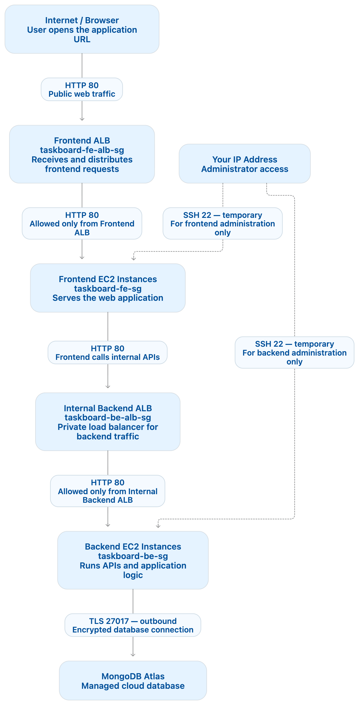

---


# Task Board AWS Architecture: Components, Roles, and Network Ports Explanation

The Task Board application uses a layered AWS architecture. Public users access only the frontend Application Load Balancer. Backend services and the database remain protected from direct internet access.

| Component | Type / Location | Responsibility | Allowed Traffic | Port |
|---|---|---|---|---:|
| Frontend ALB | Internet-facing Application Load Balancer | Receives browser requests and distributes traffic to healthy frontend servers | Internet → Frontend ALB | 80 |
| Frontend Auto Scaling Group | AWS Auto Scaling | Launches, replaces, and scales frontend EC2 instances automatically | Not directly accessed | — |
| Frontend EC2 | Application servers | Runs Nginx and serves the Task Board frontend | Frontend ALB → Frontend EC2 | 80 |
| Backend ALB | Internal Application Load Balancer | Receives internal API requests and distributes them to healthy backend servers | Frontend EC2 → Backend ALB | 80 |
| Backend Auto Scaling Group | AWS Auto Scaling | Launches, replaces, and scales backend EC2 instances automatically | Not directly accessed | — |
| Backend EC2 | Application servers | Runs Nginx and the Node.js Task Board API | Backend ALB → Backend EC2 | 80 |
| Node.js API | Local backend process | Processes API requests; backend Nginx forwards requests to this process | Backend Nginx → Node.js API | 5000 |
| MongoDB Atlas | Managed cloud database | Stores Task Board tasks and application data | Backend EC2 → MongoDB Atlas using TLS | 27017 |
| Security Groups | AWS network firewalls | Restrict access so each layer accepts traffic only from the previous trusted layer | Controls ports 80, 22, and 27017 | — |
| Administrator laptop | Management access | Used only for temporary server configuration and troubleshooting through SSH | Your IP → EC2 instances | 22 |

```text
Browser
  → Internet-facing Frontend ALB
  → Frontend EC2 Auto Scaling Group
  → Internal Backend ALB
  → Backend EC2 Auto Scaling Group
  → MongoDB Atlas
```

> Port `5000` is used only inside the backend server by the Node.js API. External and internal HTTP traffic between load balancers and EC2 instances uses port `80`.

---
# Implementation Screenshot Step by Step :

# Security Groups

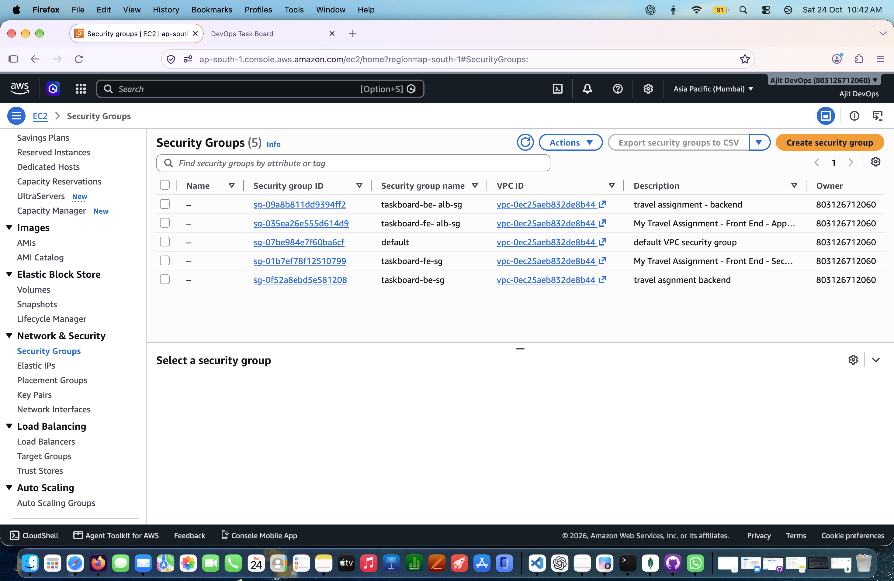
---

# EC2 Instance

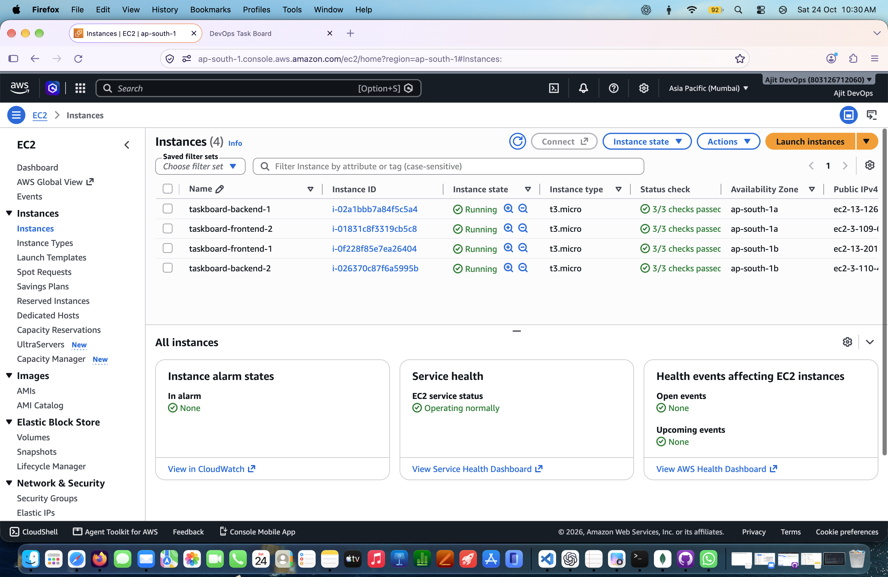
---

# AMI (Golden Images)

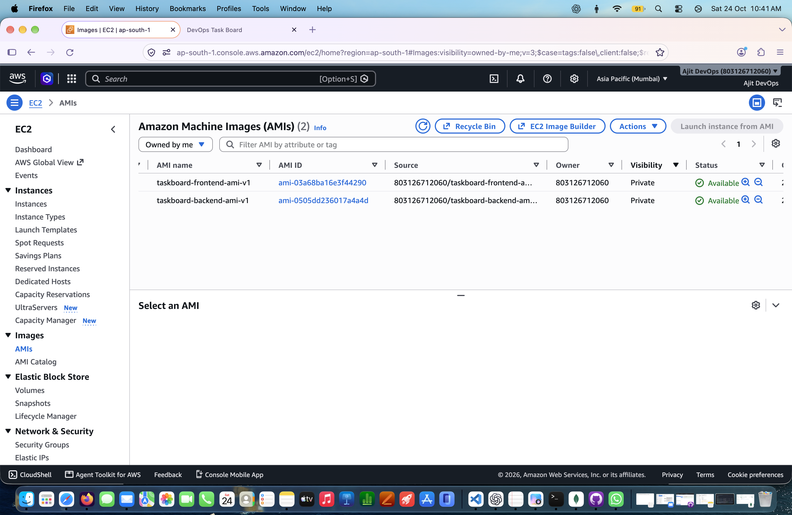
---

# Launch Templates

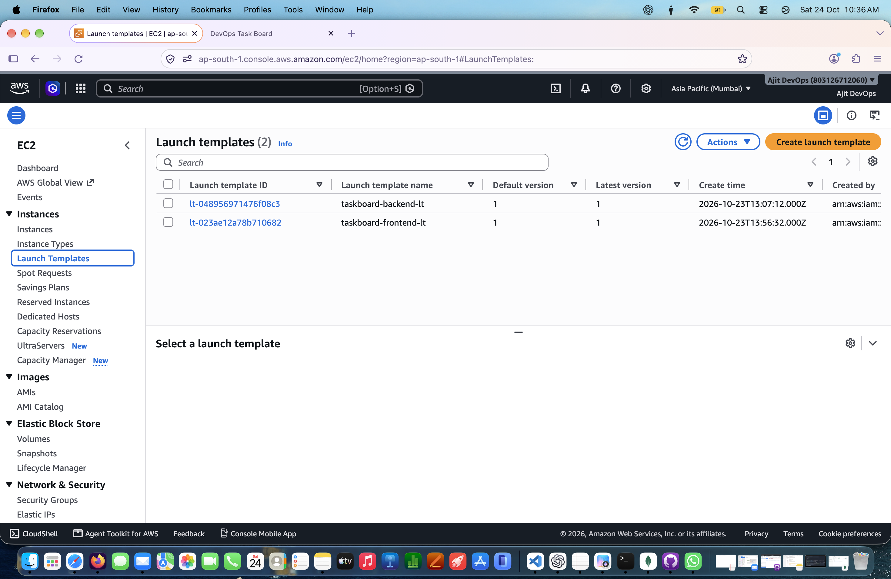
---

# Target Groups

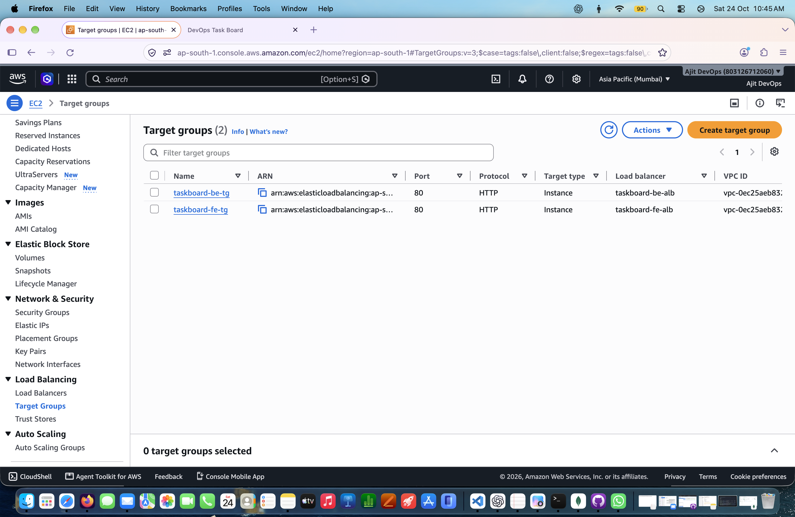
---

# Load Balancers 

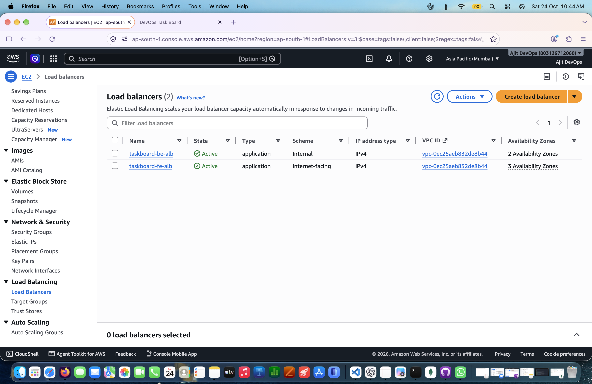
---

# Auto Scaling Groups

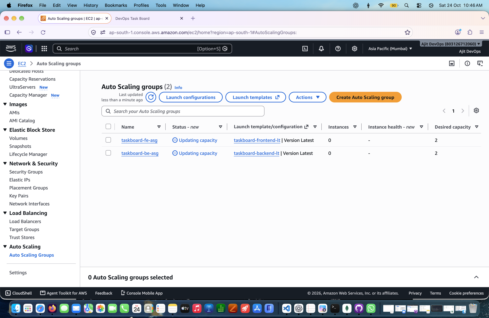
---

# Mongo DB

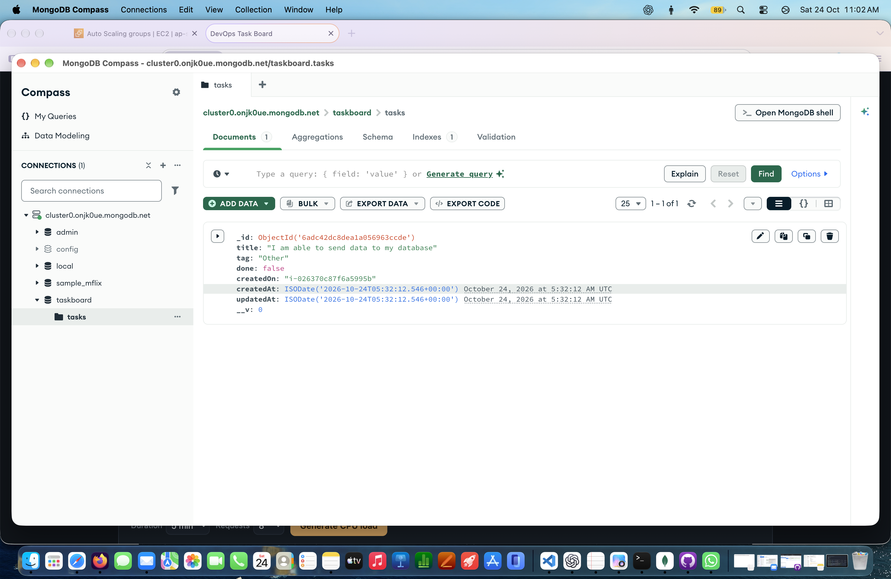
---

# Demo Proof 1

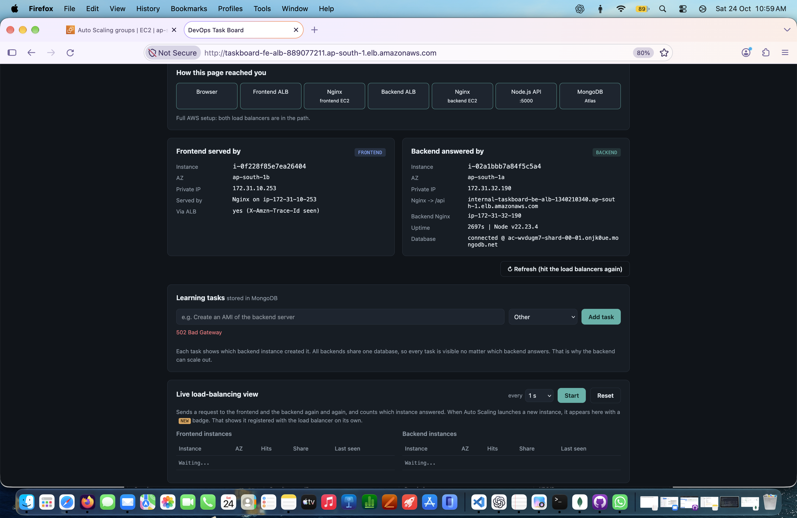
---

# Demo Proof 2

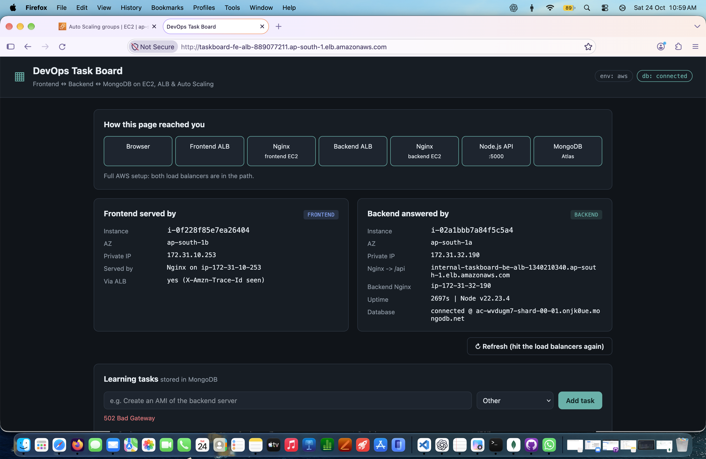
---

# Demo Proof 3

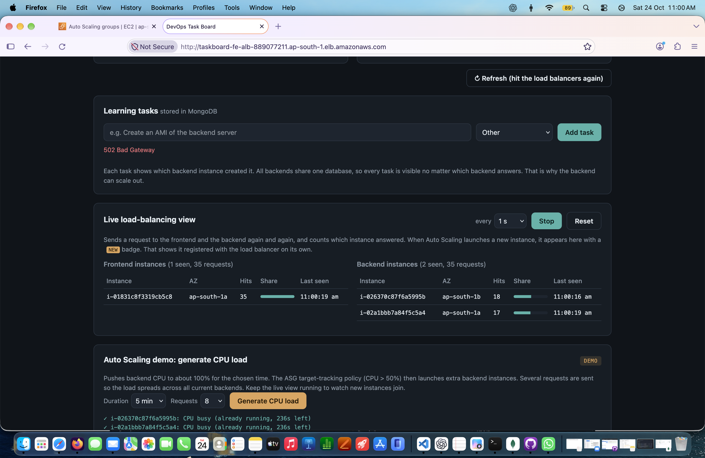
---
